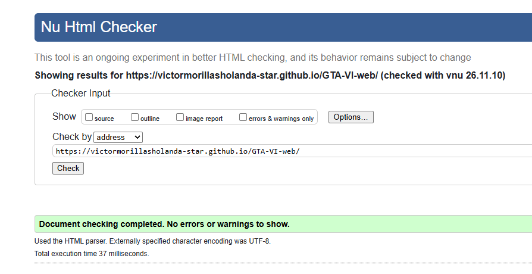
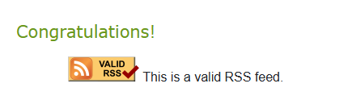

# Centro de Información sobre GTA VI

Sitio web de cinco páginas diseñado para ofrecer información detallada, noticias, personajes, recursos multimedia y un formulario de participación sobre el videojuego Grand Theft Auto VI en Vice City y el estado de Leonida. La temática de este esta inspirada en todo lo que se sabe hasta el momento sobre el juego y detalles de la vida real incluidas en el juego (como la banda sonora o el mapa en sí que esta inspirado en miami).

## Autoría
- **Nombre y apellidos:** Víctor Morillas Martínez
- **Curso:** 1 DAM
- **Módulo:** Lenguaje de Marcas
- **Año:** 2026

## Sitio publicado
- **Web en GitHub Pages:** [Abrir sitio](https://victormorillasholanda-star.github.io/GTA-VI-web/)
- **Repositorio:** [Abrir repositorio](https://github.com/victormorillasholanda-star/GTA-VI-web)

## Estructura del proyecto
- `index.html`: Página principal con el logotipo, descripción de lo que es en sí el GTA VI y resúmenes sobre cada apartado web junto a los enlaces a estos.
- `blog.html`: Artículo detallado sobre el desarrollo, historia y las novedades de  la empresa desarrolladora Rockstar Games.
- `tabla.html`: Tabla estructurada de personajes y roles con celdas combinadas y tematizadas sobre el juego.
- `galeria.html`: Galería multimedia que incluye mapa oficial, tema principal de la banda sonora, vídeo del trailer y Google Maps.
- `formulario.html`: Formulario completo de suscripción con validación HTML5 y múltiples tipos de control.
- `rss.xml`: Canal de indicación de contenidos en formato XML.
- `css/estilos.css`: Hoja de estilos externa compartida.

## Tecnologías utilizadas
- HTML5 semántico
- CSS3 (Estilos básicos)
- XML y RSS
- Git
- GitHub 
- GitHub Pages

## Características principales
- Navegación coherente y enlazada entre las cinco páginas.
- Uso riguroso de elementos semánticos (`header`, `nav`, `main`, `footer`, `article`, `section`).
- Tabla de datos accesible (`caption`, `thead`, `tbody`, `tfoot`, `scope`).
- Galería con múltiples formatos de imagen optimizados (JPG, WebP, SVG).
- Elementos multimedia locales e incrustados.
- Formulario robusto con validación nativa.
- Canal RSS validado.

## Validación
### HTML

### CSS

### RSS

## Dificultades encontradas
Describe al menos tres dificultades reales:
1. La ruta de imagen del logo originalmente se llamaba "images (16).jpg", por lo que al contener un espacio
provocaba errores de sintaxis y en el validador W3C. Lo solucioné simplemente cambiando el nombre de la imagen y de la ruta a "logo.jpg".
2. Algunas capturas de pantalla se salían de los contenedores y rompían el diseño. Lo resolví aplicando max-width: 100%` en la hoja de estilos.
3. El video en galeria.html no se reproducía en la página. Lo resolví al darme cuenta de que en src faltaba la etiqueta controls con la que el navegador puede mostrar los botones de reproducción del video.
## Decisiones técnicas
Explica brevemente:
- Cómo has organizado los archivos: He estructurado el proyecto ordenando cada tipo de recurso en su propia carpeta para mantener todo limpio, una carpeta img para las imágenes, css para los estilos, audio para los sonidos y video para los clips, dejando los ficheros HTML principales y el RSS directamente en la raíz.
- Qué partes de la plantilla se repiten: el logotipo de la cabecera, el menú de navegación (nav) y el pie de página (footer).
- Qué cambia en cada página: el titulo y el main (detalles, imagenes, audios..etc)
- Por qué has elegido determinados formatos de imagen: porque tienen una gran calidad para el peso que tienen.
- Cómo has utilizado rutas relativas: para los enlaces e imagenes usando css/estilos.css o img/logo.jpg
- Cómo has preparado el proyecto para la siguiente práctica de CSS: enlazando la hoja de estilos en cada HTML
## Fuentes y licencias
Las imagenes pertenecen a la desarrolladora Rockstar games obtenidas de https://www.rockstargames.com/, el audio le pertenece a los artistas Chimbala Y Omega siendo obtenida de youtube https://www.youtube.com/watch?v=yxlE4alDecE y el video proviene del canal oficial de Rockstar Games de youtube https://www.youtube.com/@RockstarGames.
